

  

  
  
  
  

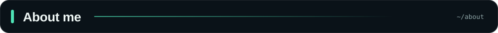

I'm a third-year B.Tech student in Computer Science and Engineering (Data Science) at Pranveer Singh Institute of Technology, Kanpur. What I enjoy most is taking a model out of a notebook and turning it into something a person can open in a browser, so I work on both the ML side and the web side.

Outside coursework I practise DSA in Java, enter ML hackathons, and spend more time than I should on geopolitics, economics, philosophy and literature.


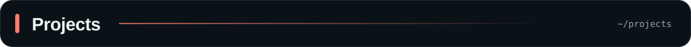

<a href="https://github.com/SubhamMandal-2k24/RadiantXAI"></a>

  <a href="https://github.com/SubhamMandal-2k24/DeepShield-Project"></a>
  <a href="https://github.com/SubhamMandal-2k24/MergeGuard"></a>

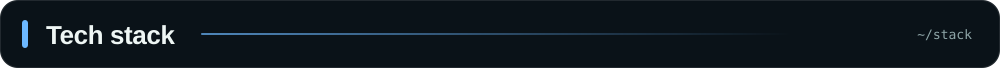


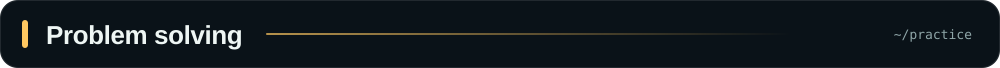

  <a href="https://leetcode.com/u/Subham_Mandal_2006"></a>
  <a href="https://www.codechef.com/users/subham_mandal"></a>

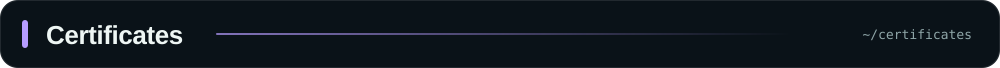

  <a href="https://www.coursera.org/account/accomplishments/specialization/KS8LM8QB6N3I"></a>
  <a href="https://www.credly.com/go/tXCZTp0d"></a>

